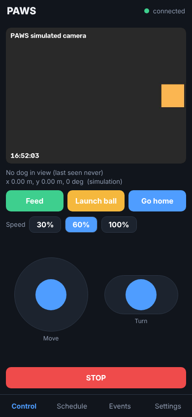
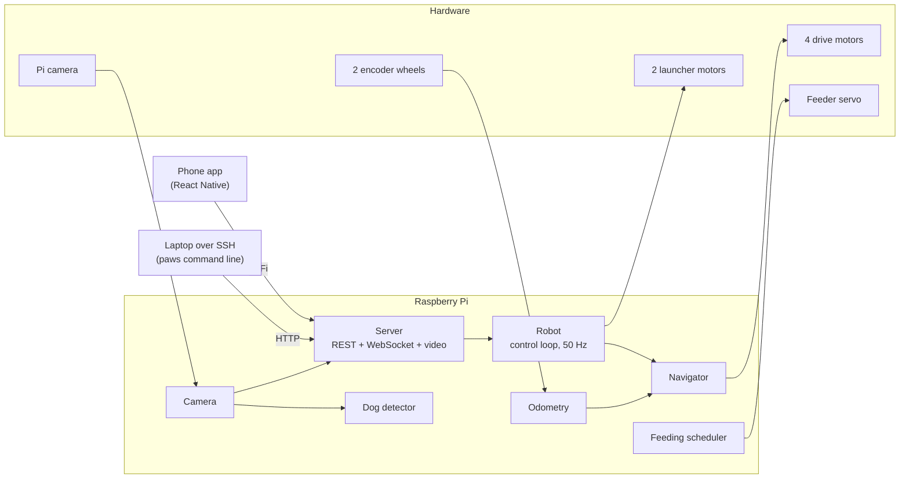

# PAWS: Pet Automated Watch and Security

PAWS is a robot that keeps a dog company while nobody is home. It drives around the house, streams live video to your phone, throws a ball, dispenses food on a schedule, and logs an alert with a photo when it spots the dog.

It was built as a senior engineering project. The chassis is fully 3D printed and a Raspberry Pi runs everything.



## What it can do

| Feature | How |
| --- | --- |
| Drive in any direction | Four motors in an X-drive layout: forward, sideways and turning, all at once |
| Know where it is | Two unpowered omni wheels with encoders track real movement across the floor |
| Drive itself | Go to a point, patrol a list of waypoints, or return home |
| Play fetch | Two counter-rotating flywheels launch a ball |
| Feed the dog | A servo dispenser, on demand or on a daily schedule |
| Watch | Live camera stream to the phone app or any browser |
| Spot the dog | On-board object detection logs an event with a snapshot |
| Be controlled from anywhere in the house | Phone app over WiFi, or a command line tool over SSH |

## How it works



Everything goes through one program on the Pi, the **server**. The phone app and the command line tool are both just clients of it, so they always agree and can be used at the same time.

**Driving.** An X-drive has four omni wheels at the corners, each turned 45 degrees. A drive command is three numbers: forward, sideways and turn. `paws/drivetrain.py` mixes them into four wheel powers:

```
front left  = forward - left - turn        front right = forward + left + turn
back left   = forward + left - turn        back right  = forward - left + turn
```

If any wheel would need more than 100% power, all four are scaled down together so the robot still goes in the direction you asked.

**Motors.** Each motor controller takes two direction pins and one PWM pin. `paws/hardware/motor.py` sets the direction pins for forward or reverse and the PWM duty cycle for speed.

**Knowing where it is.** Drive wheels slip, so position comes from two free-spinning omni wheels pressed against the floor. One rolls forward and back, the other side to side. `paws/odometry.py` reads their encoders 50 times a second and adds up the small movements into an x, y position measured from where the robot started.

**Driving itself.** `paws/navigation.py` compares where the robot is with where it should be and drives harder the further away it is (a proportional controller). Because the X-drive can move in any direction, it corrects x, y and heading together.

**Seeing the dog.** A background thread grabs camera frames. About once a second one frame goes through YOLOX, a small neural network that recognises 80 kinds of object, and PAWS keeps only the "dog" results. When a dog appears after being out of view, an event is saved with a photo that has a box drawn around the dog.

**Staying safe.** A robot on WiFi must never keep going when the connection drops:

* Drive commands expire after half a second. The app re-sends them ten times a second while a joystick is held; if they stop arriving, the wheels stop.
* The launcher always shuts itself off after a few seconds and has a hard time limit.
* Touching a joystick cancels any autonomous driving right away.
* One STOP command halts wheels, launcher and navigation together.

## Hardware

* Raspberry Pi 4 (or 5) with Raspberry Pi OS
* Raspberry Pi camera module
* 4 REV drive motors with omni wheels, X-drive layout
* 2 REV motors for the ball launcher flywheels
* 6 motor controller channels (2 direction pins + 1 PWM pin each)
* 1 REV servo for the feeder
* 2 quadrature encoders on omni tracking wheels
* Fully 3D printed chassis

Wiring and the default pin numbers are in [docs/WIRING.md](docs/WIRING.md).

> **The pin numbers in `config.yaml` are placeholders.** We did not have the original wiring notes when this code was written, so change them to match your robot before running on real hardware.

## What is in this repository

```
paws/                  Python code that runs on the Pi
  hardware/            motor, encoder and servo drivers
  drivetrain.py        X-drive maths
  odometry.py          position tracking from the encoder wheels
  navigation.py        go-to-point and patrol
  launcher.py          ball launcher
  feeder.py            food dispenser
  scheduler.py         feeding schedule
  camera.py            camera capture and streaming
  detection.py         dog detection
  events.py            event log with snapshots
  robot.py             ties everything together, safety rules
  server.py            REST + WebSocket + video server
  cli.py               command line tool
  sim.py               simple physics for running without a robot
mobile/                phone app (React Native with Expo)
tests/                 automated tests (run in simulation)
scripts/               Pi install script and auto-start service
docs/                  wiring and API reference
config.yaml            every pin number and setting
```

## Try it without a robot

The code has a simulation mode with fake motors, fake encoders driven by a small physics model, and a test-pattern camera. It turns on automatically on any computer that is not a Raspberry Pi.

```bash
git clone <your repo url> PAWS && cd PAWS
python3 -m venv .venv && source .venv/bin/activate
pip install -e ".[dev]"

python -m paws serve            # terminal 1: start the simulated robot
python -m paws teleop           # terminal 2: drive with the keyboard
```

Then open <http://localhost:8000/docs> to explore the API in a browser, or <http://localhost:8000/api/camera/stream> to see the video.

## Install on the Raspberry Pi

```bash
ssh pi@<robot ip>
git clone <your repo url> PAWS && cd PAWS
./scripts/install.sh            # installs dependencies and the detection model
nano config.yaml                # set your real pin numbers
```

First run, with the wheels off the ground:

```bash
source .venv/bin/activate
python -m paws hwtest           # spins each motor, moves the servo, reads encoders
```

`hwtest` tells you what to look for. If a wheel spins backwards, set `inverted: true` for it in `config.yaml`. Do the same for an encoder that counts the wrong way.

Then start the robot:

```bash
python -m paws serve
```

To start it automatically on every boot:

```bash
./scripts/install_service.sh
```

### Calibration

Three numbers in `config.yaml` are worth measuring on your robot:

* `encoders.ticks_per_rev` and `encoders.wheel_diameter`: push the robot exactly one metre and check that `python -m paws status` reports x = 1.00.
* `drive.max_speed`: time the robot over a known distance at full power.
* `drive.max_turn_rate`: time one full spin at full turn power, then use 6.28 divided by the seconds it took.

## Controlling it over SSH

SSH into the Pi and use the `paws` tool (`python -m paws ...`). The same commands also work from a laptop on the same WiFi by adding `--host <robot ip>`.

| Command | What it does |
| --- | --- |
| `paws teleop` | Drive with the keyboard: `w/a/s/d` move, `q/e` turn, `f` feed, `l` launch, `space` stop |
| `paws status` | Position, what is running, last feeding, whether the dog is in view |
| `paws feed -n 2` | Dispense two portions now |
| `paws launch --power 0.9 --duration 2` | Throw a ball |
| `paws schedule add 08:00 --days weekdays -n 2` | Add a feeding time |
| `paws schedule` | Show the feeding schedule |
| `paws goto 1.5 0.5 --heading 90 --wait` | Drive to a point (metres from the start position) |
| `paws patrol 1,0 1,1 0,1 0,0 --loops 3` | Visit waypoints in order |
| `paws events` | Recent feedings, launches and dog sightings |
| `paws snapshot -o dog.jpg` | Save a camera frame |
| `paws stop` | Emergency stop |
| `paws --help` | Everything else |

## Phone app

The app lives in [mobile/](mobile/README.md). It has four tabs:

* **Control**: live video, a joystick to move, a slider stick to turn, Feed, Launch, Go home and STOP
* **Schedule**: add, pause and delete feeding times
* **Events**: history of feedings, launches and dog sightings, with photos
* **Settings**: the robot's address, plus detection and home-position controls

To run it on your phone, install the free **Expo Go** app, then:

```bash
cd mobile
npm install
npx expo start
```

Scan the QR code, open the Settings tab and enter the Pi's IP address (run `hostname -I` on the Pi to find it). The phone and the robot must be on the same WiFi network.

## API

The full reference is in [docs/API.md](docs/API.md), and a live, clickable version is served by the robot at `/docs`. The short version:

```bash
curl http://<robot ip>:8000/api/status
curl -X POST http://<robot ip>:8000/api/feeder/dispense -H 'Content-Type: application/json' -d '{"portions": 1}'
curl -X POST http://<robot ip>:8000/api/stop
```

## Tests

```bash
pip install -e ".[dev]"
pytest
```

The tests run the real control code against the simulator: wheel mixing, position tracking, navigation, the watchdog, the feeder, the scheduler and the whole HTTP and WebSocket API.

## Known limits and ideas for later

* **Heading drifts.** Two tracking wheels measure x and y but cannot measure rotation. By default PAWS estimates heading from its own turn commands, which drifts over time. Adding a gyro (for example a BNO055) and passing its angle to `Odometry.update(heading=...)` would fix this.
* **No obstacle sensing.** Autonomous moves assume a clear floor. Use them in an open area.
* **Home WiFi only.** There is no login beyond an optional shared token, so do not expose the port to the internet. A VPN such as Tailscale is the easy way to reach it from outside.
* **Fast encoders.** Python can miss counts from high-resolution encoders at high wheel speeds. If position under-reads at speed, a hardware counter or a lower resolution encoder helps.
* Ideas: follow the dog with the camera, bark detection with a microphone, two-way audio, a treat counter per day.

## Team

PAWS was designed and built by our senior engineering project group. <!-- Add your names here -->

## License

MIT. See [LICENSE](LICENSE).
