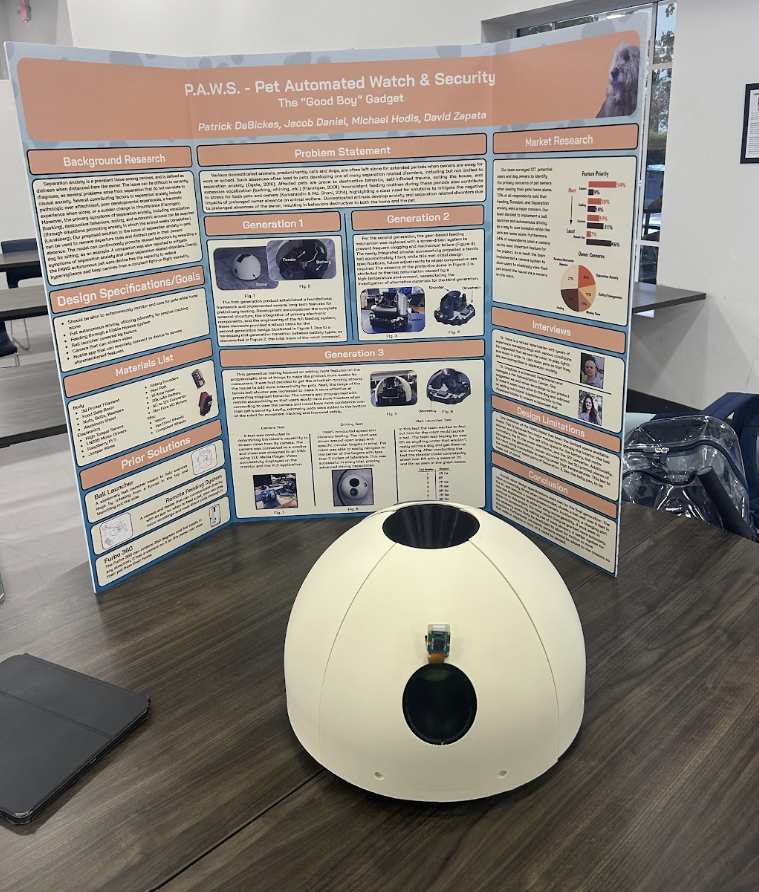
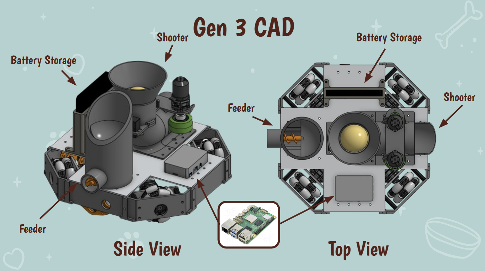
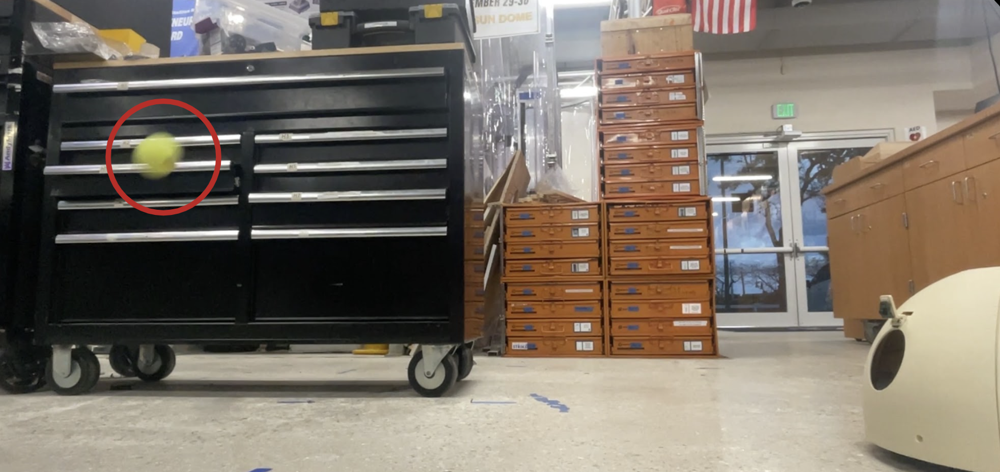
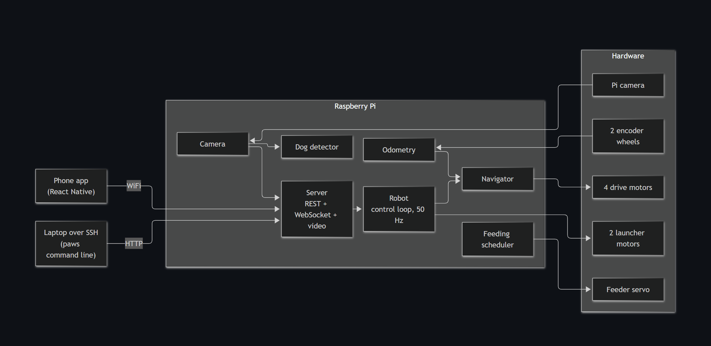

# PAWS: Pet Automated Watch and Security

PAWS is a robot we designed and built for our senior-year engineering project to help owners interact with their dogs while away from home. It combines a ball launcher, food dispenser, camera, and mobile controls in a 3D printed body.

  

## Our design

We brought the driving system, ball launcher, food dispenser, and electronics together in one compact robot. The rounded outer shell covers the internal mechanisms, while openings provide access to the launcher and feeder.

Four angled omni wheels let PAWS move forward, backward, and sideways, as well as turn. Two separate tracking wheels help estimate how far it has moved. A Raspberry Pi coordinates the robot's functions.

The ball launcher uses two spinning wheels to propel a ball outward. The food dispenser releases food on command or according to a feeding schedule. Our CAD layout shows how these mechanisms fit alongside the batteries and electronics.

## What it does

- **Moves around:** Drive PAWS from a phone or have it follow a set of points.
- **Plays fetch:** Launch a ball using the built-in launcher.
- **Dispenses food:** Feed on demand or set a daily schedule.
- **Keeps watch:** View live camera footage and save a photo when your dog is detected.

The phone app connects over home WiFi and brings the driving controls, camera view, feeding, and launcher together. A stop control halts movement and the launcher, and the drive motors stop if manual control commands stop arriving.

## How it works

The Raspberry Pi connects the phone controls to the robot's mechanisms and sends camera footage back to the app.

PAWS is a student-built prototype. Autonomous movement needs a clear floor because it does not have obstacle sensing, and its position estimate can drift over time.
